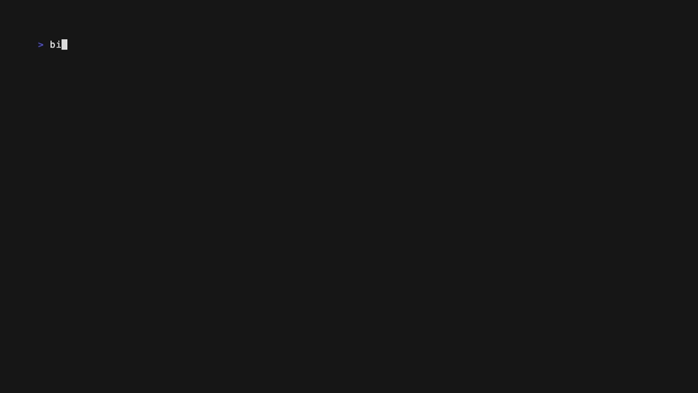
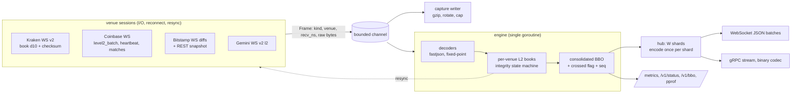

# marketmux

A multi-venue crypto market-data platform in Go. It connects to Kraken, Coinbase, Bitstamp and
Gemini public feeds and keeps a validated L2 book per venue using each venue's own integrity
mechanism. It builds a consolidated cross-venue BBO and fans it out to many consumers over
WebSocket and gRPC with explicit slow-consumer policies. Every run is captured and can be replayed
bit-identically.

[](https://github.com/eshaan2418/marketmux/actions/workflows/ci.yml)


> Educational/research project. Not investment advice. No live trading. Public market-data
> channels only: no API keys, no order entry.

## Headline numbers

Apple M5 Pro laptop, Go 1.27.3. Live figures come from a 30-minute session on 2026-11-01 (4 venues ×
5 symbols); raw output is in [`research/results/`](research/results/) and
[`bench/results/`](bench/results/).

| metric | value |
|---|---|
| Live session | 694,941 frames in 30 min, **0 decode errors, 0 resyncs, 0 disconnects** |
| Kraken checksum verification | **259,164 / 259,164** CRC32 checksums matched |
| Replay == live | identical output hash (`5921621457644666170`) live and on 5/5 replays |
| Replay throughput (decode + books + checksums + consolidation) | **289k frames/s** median (~750× the live 386 frames/s) |
| Engine time per frame (replay) | p50 1.4 µs, p99 45 µs (max driven by Bitstamp's ~7k-level REST snapshots) |
| Hot-path allocations (decode → book → consolidate → publish) | **0 allocs/frame** (tested) |
| Fan-out, 100 WS clients × 2,000 updates/s (200k msgs/s) | p50 **316 µs**, p99 675 µs, end-to-end over loopback |
| Fan-out, 1,000 WS clients × 200 updates/s | p50 2.4 ms, p99 4.0 ms; 10% stalled clients leave these unchanged |
| Live receive → consolidated publish (clean 10-min session) | p50 18.5 µs, p99 0.60 ms |

## Demo

`make demo` connects to the live venues and renders the consolidated book; this GIF was recorded
from the live public feeds:



## Why it matters

Crypto liquidity is fragmented across venues that, unlike US equities under Reg NMS, are not
linked: there is no consolidated tape, no NBBO and no trade-through rule. Every market maker,
arbitrage desk and smart order router therefore runs its own platform. It speaks each venue's
protocol, keeps a replica of each book that is provably in sync, merges the replicas into a
consolidated view, and distributes that view to many internal consumers. A replica that is
silently wrong is worse than one that is missing, and one slow consumer must not delay the
others. This project builds that platform and measures it on live data.

## Highlights

- **Per-venue integrity, not just parsing**:
  - Kraken: CRC32 verified after every update, with depth truncation.
  - Bitstamp: diffs bridged to a REST snapshot by microtimestamp.
  - All venues: sequence-gap detection is connection-wide, a crossed own book is detected and
    resynced if it persists, and disconnects invalidate the venue.
  - Untrusted books leave the consolidated view immediately.
- **Exact decimals**: prices are parsed from JSON text, including Kraken's JSON numbers, straight
  into fixed-point int64, never via float64. Round-trip exactness is fuzzed.
- **Deterministic replay**: raw frames (including REST snapshots and connect/disconnect markers)
  are captured and replay through the same single-goroutine engine. Output hashes prove
  replay == live. A test caught a real non-determinism (map-order iteration on resync) that is now
  fixed.
- **Slow-consumer policies that never block the engine**: conflate, bounded queue with drop, or
  disconnect, plus throttled conflation (`?interval=10ms`), a write timeout for dead peers, and
  shard-level shedding. All are measured with stalled clients.
- **A finding from real data**: the consolidated BTC/ETH/SOL/XRP book was crossed 97-99.99% of the
  time, by a median 1.4-2.4 bps. Gemini quotes and trades at a persistent premium, while each venue's
  own book was consistent. The cross stays well below two-leg taker fees.

## Quick start

```bash
# macOS or Linux, Go 1.27+
make build test                 # build all binaries; unit, property, integration tests
make race                       # same under the race detector
make data DURATION=10m          # record a bounded live session (no keys) to a capture directory
make replay                     # replay the capture as fast as possible, prints output hash
make fanout-bench               # fan-out benchmark matrix (in-process loopback)
make demo                       # live consolidated book in the terminal

bin/marketmux -symbols BTC-USD,ETH-USD -listen :8080 -grpc :9090     # serve live
curl -s localhost:8080/v1/bbo?symbol=BTC-USD; curl -s localhost:8080/metrics | grep marketmux_
websocat 'ws://localhost:8080/ws?symbols=BTC-USD&policy=conflate'    # JSON arrays of updates
```

Captures are never committed. `make data` records your own, bounded by duration and a 2 GB cap.

## Architecture



**Data flow.** Each session reads frames and stamps them with a monotonic receive time. The
engine decodes them with a reused parser into reusable level slices, applies them to the venue
book and checks integrity. A book that fails is marked DEAD, cleared, removed from consolidation,
and a resync is requested. When a venue's top changes, the engine recomputes the consolidated BBO
across valid venues and publishes it. The hub copies the update to W shard inboxes. Each shard
worker encodes it once and offers the shared bytes to its clients under their policy, and each
client's writer batches everything ready into one WebSocket message.

**Threading.** One goroutine per session reader, one engine goroutine owning all books (no locks
on the data path), W hub shard workers, and one writer goroutine per client. `Publish` never
blocks. Details are in [`docs/DESIGN.md`](docs/DESIGN.md), and the market mechanics are in
[`docs/MICROSTRUCTURE.md`](docs/MICROSTRUCTURE.md).

## Correctness

| layer | what it checks |
|---|---|
| Decoder tests | every venue message shape (book snapshot/delta, trades, heartbeats, acks, unknown symbols), timestamps |
| Fuzzing | all decoders on arbitrary bytes (no panics, no negative levels); fixed-point parse round trip and agreement with float; gRPC codec decode → encode → decode |
| Book | differential test vs a map-based reference (180k random updates × 3 depths incl. truncation); invariants (strict ordering, positive qty, depth bound); allocation-free at capacity |
| Engine | Kraken checksum construction and failure → resync; Bitstamp bridging (stale drop, duplicate, out-of-order, buffer overflow); connection-wide gap; disconnect invalidation; transient vs persistent own-book cross; consolidated BBO vs brute force under random snapshots/disconnects; replay determinism (50× repeated); zero allocs per frame |
| Fan-out | conflate keeps the latest, queue drops, disconnect closes, encode-once shares bytes, `Publish` never blocks, slow-client isolation |
| Integration | fake venue over real WebSocket → session → engine → hub → WS and gRPC clients, with an injected sequence gap and dropped connection; recovery and gap-free delivery verified |
| Live | 30 min: 0 decode errors, 0 checksum failures, 0 resyncs; replay of the capture reproduces the live hash |

All tests run under `go test -race` in CI (macOS and Linux).

## Performance

**Methodology.**
- Live latency comes from a clean 10-minute session, separate from the 30-minute one, which ran
  while tests were executing.
- Replay measures the engine on the 30-minute capture, 5 runs.
- Fan-out uses `mmbench`, which injects frames at a fixed rate into the engine and hub, with N
  clients in the same process connected over loopback WebSocket or gRPC. Each client measures
  injection → receipt on the same monotonic clock. 3 runs per configuration, medians reported.
- Micro-benchmarks use Go's `testing` package with `-benchmem`, 5 runs.

Fan-out (`bench/results/fanout-20261101-235809/SUMMARY.md`):

| configuration | delivered msgs/s | p50 | p99 | p99.9 |
|---|---|---|---|---|
| WS, 10 clients × 20,000 upd/s | 199k | 73 µs | 173 µs | 260 µs |
| WS, 100 clients × 2,000 upd/s, conflate | 199k | 316 µs | 675 µs | 905 µs |
| WS, 100 clients × 2,000 upd/s, queue | 199k | 303 µs | 616 µs | 872 µs |
| WS, 1,000 clients × 200 upd/s | 199k | 2.4 ms | 4.0 ms | 5.2 ms |
| WS, 1,000 clients × 5,000 upd/s, throttled conflation 10 ms | 497k | 688 µs | 2.1 ms | 8.4 ms |
| WS, 1,000 clients × 5,000 upd/s, unthrottled | 1.09M (saturated) | 560 ms | 858 ms | 1.1 s |
| gRPC, 100 clients × 2,000 upd/s | 199k | 893 µs | 1.3 ms | 1.5 ms |
| gRPC, 1,000 clients × 200 upd/s | 218k (saturated) | 132 ms | 4.0 s | 7.2 s |

Stalled consumers: 100 of 1,000 clients connect and never read. In every policy, fast clients'
p50/p99 stay at 2.2-2.3 ms / 3.7-3.8 ms with 0 gaps. The server conflated 98,900 updates (conflate)
or dropped 73,800 (queue/disconnect). Stalled peers were cut off by the write timeout, or by policy
under disconnect.

Micro-benchmarks (`bench/results/micro.txt`, median of 5):

| operation | ns/op | allocs |
|---|---|---|
| decode Kraken book update | 380 | 0 |
| decode Coinbase l2update | 262 | 0 |
| decode Bitstamp diff (5 levels) | 463 | 0 |
| decode Gemini l2_update | 173 | 0 |
| L2 book update near touch (500 levels) | 41 | 0 |
| map-based reference book, same workload | 536 (13× slower) | 0 |
| engine: synthetic frame end-to-end | 650 | 0 |
| hub publish to 1,000 conflating clients | 95 (engine-side cost) | 0 |
| JSON encode of an update | 139 | 0 |

**Caveats, stated plainly.**
- **Laptop.** Fan-out clients share the CPU with the server. A separate, unrelated workload was
  running on this machine during the fan-out matrix (load average 12-16, recorded in
  `machine.txt`), so absolute fan-out numbers are pessimistic and noisy.
- **Syscall-bound fan-out.** 72% of CPU went to `write(2)` in the saturated case (`docs/PERF_LOG.md`).
  The scaling answer is throttled conflation, multicast, or kernel bypass for co-located consumers,
  not more Go.
- **gRPC** saturates at about 1,000 streams on this machine, where WebSocket with batching does not.
- **Excluded from latency:** TLS decryption and the network path to the venues. Internet latency
  to the venues (tens of ms) dominates real tick-to-consumer time.
- **macOS loopback buffers.** macOS auto-tunes loopback receive buffers up to 4 MB regardless of
  `SO_RCVBUF`, so a slow-but-reading client can buffer tens of seconds of data in the kernel before
  back-pressure reaches the server. The server's `SO_SNDBUF` is bounded (`-sndbuf`).

Optimisation history (batching, encode-once, profiling, allocation removal, the determinism fix) is
in [`docs/PERF_LOG.md`](docs/PERF_LOG.md).

## Real data: what the consolidated book looks like

From the 30-minute live session (`research/results/live_session.json`, `venue_premium.json`):

| symbol | consolidated book crossed (time) | cross size p50 / p99 (bps) | best bid set by (time share) | best ask set by |
|---|---|---|---|---|
| BTC-USD | 99.99% | 2.39 / 5.14 | Gemini 81%, Bitstamp 14% | Coinbase 64%, Kraken 18%, Bitstamp 18% |
| ETH-USD | 99.98% | 1.81 / 4.96 | Gemini 92% | Kraken 69%, Bitstamp 25% |
| SOL-USD | 97.18% | 2.12 / 7.01 | Gemini 90% | Bitstamp 41%, Kraken 33%, Coinbase 26% |
| XRP-USD | 98.70% | 1.36 / 4.17 | Gemini 85% | Kraken 46%, Bitstamp 45% |
| LTC-USD | 36.65% | 0.54 / 11.4 | Coinbase 67%, Kraken 20% | Kraken 40%, Bitstamp 34% |

Gemini's mid sat a median 1.3-2.9 bps above the other venues' mid, and its trades printed
1.3-2.8 bps above it too. So the premium is real, not a stale replica. With two-leg taker fees of
roughly 10-120 bps, a 2 bps cross is not an arbitrage. This is why the consolidated update carries
a `Crossed` flag rather than "correcting" the book.

## Design decisions and trade-offs

| decision | chosen | rejected, and why |
|---|---|---|
| decimal type | fixed-point int64 parsed from text | float64 (breaks Kraken checksums, inexact equality) |
| engine concurrency | one goroutine owns all books | per-symbol goroutines with locks (no throughput need; loses determinism) |
| integrity on failure | mark DEAD, remove from consolidated, resync | keep publishing (silently wrong prices) |
| own book crossed | exclude now, resync after 5 consecutive crossed updates | resync immediately (Bitstamp's batched diffs cross transiently: 3 unnecessary resyncs in 10 min) |
| capture content | raw frames incl. REST/connect markers | normalised events (replay would not test decoders or resync paths) |
| fan-out | sharded hub, per-client policy, encode once, batch | per-client channels written by the engine (O(clients) on the hot path; blocking dilemma) |
| gRPC schema | hand-registered service + binary codec | protoc codegen (not available in this toolchain; would be the team default) |
| JSON | fastjson + append encoder | encoding/json (reflection, allocations) |

## Limitations and roadmap

- Periodic snapshot reconciliation for Coinbase and Gemini, to measure divergence that
  self-consistency cannot see.
- Move the Bitstamp REST snapshot decode off the engine goroutine, to remove the multi-ms max per
  frame.
- Pooled read buffers in sessions (`c.Reader`), to remove the remaining per-frame allocation on the
  receive path.
- Shard the engine by symbol once frame rates approach about 20k/s.
- Internal binary multicast transport for co-located consumers. Authentication and entitlements on
  the client API.
- More venues: Binance.US and OKX, whose sequence-numbered depth diffs make bridging exact.

## Related projects

- [itchbook](https://github.com/eshaan2418/itchbook): NASDAQ ITCH 5.0 L3 feed handler (C++). The
  equities counterpart of marketmux's crypto venue handlers.

## Project structure

```
cmd/marketmux     server: sessions, engine, capture, WS/gRPC/HTTP
cmd/mmbench       fan-out benchmark (in-process loopback clients)
cmd/mmwatch       terminal client (demo)
cmd/mmanalyze     capture analysis: venue premium, trades vs mid
internal/model    fixed-point decimals, schema
internal/venue    decoders (Kraken, Coinbase, Bitstamp, Gemini, synthetic), sessions, checksum
internal/book     L2 book
internal/pipeline engine, integrity state machine, consolidated BBO, analytics
internal/fanout   sharded hub, slow-consumer policies
internal/server   WebSocket/gRPC/HTTP, JSON and binary codecs
internal/capture  capture writer/reader
internal/fakevenue synthetic venue + fault-injecting WS server
internal/integration end-to-end tests
bench/, research/ benchmark scripts and raw results; analysis outputs; demo tape
docs/             DESIGN, MICROSTRUCTURE, PERF_LOG, DEEP_DIVE (interview Q&A)
```

## License

MIT. See [LICENSE](LICENSE). Educational/research project. Not investment advice. No live trading.
Market data is consumed from the venues' public endpoints under their terms and is not
redistributed.
